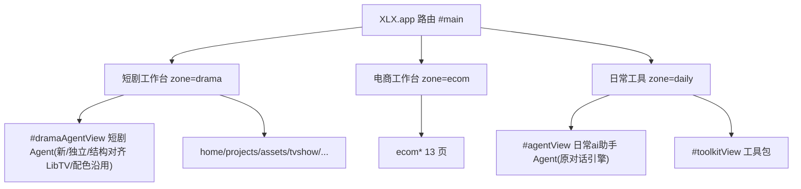

# 技术设计：日常工具分区 + 短剧 Agent 对齐 LibTV

关联需求：`.monkeycode/specs/2026-10-09-daily-tools-zone/requirements.md`

## 1. 目标与范围

- 顶层分区由 2 个扩展为 3 个：短剧工作台 / 电商工作台 / 日常工具。
- 把短剧工作台里的「工具包」与通用对话「铜龙电商ai助手 Agent」迁入「日常工具」。
- 通用对话更名「日常ai助手 Agent」，历史保持沿用。
- 短剧工作台新增一个全新独立、结构与交互对齐 LibTV 的「短剧 Agent」，配色沿用工作台现状。
- 「短剧 Agent」感知当前画布并可对其直接下达指令；不引入 LibTV 深色主题。

不在范围内：电商工作台内部逻辑、管家 `/workspace/tonglong-ui`、全局主题换肤。

## 2. 现状架构

- 分区模型在 `src/drama/shell.js`：`ZONES`（drama/ecom）、`ZONE` 持久化键 `xlx_zone`、`zone()`/`setZone()`/`navForZone()`/`zoneOfView()`；侧栏 CSS 通过 `#sidebar[data-zone="ecom"]` 覆盖。
- 短剧导航 `shell.js` 的 `NAV` 含 `agent`（`shell.js:7`）与 `toolkit`（`shell.js:17`）。
- 通用对话引擎 `XLX.chat`（`index.html:1966`），DOM 宿主 `#agentView`（`index.html:594`），历史存 `xlx_conversations` / `xlx_chat_meta`。
- 工具包视图 `src/drama/toolkit.js`，DOM 宿主 `#toolkitView > #dramaToolkit`。
- 路由 `XLX.app`（`index.html:4477`）：`VIEWS`、`VIEW_EL`、`COMPAT`、`renderView()`、`go()`、`renderTopbar()`、`renderMobileNav()`、`init()`。
- 底层模型调用 `XLX.llm.chat(messages, opts)`（`index.html:1090`），流式 `onDelta/onDone/onError`；无 Key 判定 `XLX.llm.isConfigured()`。
- 画布感知能力 `XLX.drama.agent`（`src/drama/agent.js`），提供 `promptContext()` / `canHandle()` / `handle()`，属于短剧能力层，非通用对话引擎。

## 3. 目标架构

分区归属（`zoneOfView`）：
- `ecom*` → ecom
- `agent` / `toolkit` / `studio` / `tools` → daily
- 其余（含 `dramaAgent`）→ drama

## 4. 组件设计

### 4.1 分区模型（`src/drama/shell.js`）

- `ZONES` 增加 `{ id: "daily", label: "日常工具" }`。
- `zone()` 白名单扩展为 `drama | ecom | daily`，缺省 `drama`。
- 新增 `DAILY` 导航定义（模块内常量）：
  - `{ id: "agent", label: "日常ai助手 Agent", icon: "chat" }`
  - `{ id: "toolkit", label: "工具包", icon: "grid" }`
- `NAV` 调整：移除 `agent`、`toolkit`；在 `newProject` 之后新增 `{ id: "dramaAgent", label: "短剧 Agent", icon: "chat" }`。
- `navForZone(z)`：`ecom → ecom.NAV`、`daily → DAILY`、其余 → `NAV`。
- `zoneOfView(v)`：按第 3 节规则；新增常量映射，替代单一 `ecom` 前缀判断。
- `setZone(z)`：接受 `daily`；切换默认视图：`ecom → ecom.DEFAULT_VIEW`、`daily → "agent"`、`drama → "home"`。
- `sidebarHtml()`：`shellCreate` 由当前 `z !== "ecom"` 收紧为 `z === "drama"`，确保日常工具不显示「新建项目」。
- 导出补充 `DAILY`，供测试与移动端复用。

### 4.2 短剧 Agent（全新独立模块 `src/drama/dramaagent.js`）

- 命名空间：`XLX.drama.dramaAgent = { render, send, newConv, current, ... }`。
- DOM：新增 `

`，渲染器挂到 `#dramaAgent`。
- 独立存储（不与 `XLX.chat` 共用）：
  - 对话列表 `xlx_drama_agent_convs`（JSON 数组，上限 60）。
  - 当前对话指针 `xlx_drama_agent_current`。
- 发送管线（对齐 LibTV Agent 直接参与当前工程的行为）：
  1. 先做画布指令识别（复用 `XLX.drama.agent.canHandle(text)`）；命中则调 `XLX.drama.agent.handle(text)` 直接操作画布，并把结果作为回复回流，不进入模型调用。
  2. 未命中指令时组装 `messages = [system(短剧专属), ...本对话历史]`，并追加 `XLX.drama.agent.promptContext()` 以带入当前画布实况（无工程或画布模块缺失时为空串，自动跳过）。
  3. 调 `XLX.llm.chat(messages, { onDelta, onDone, onError, signal })` 流式渲染。
  4. 富文本渲染复用 `XLX.util.renderFull`；缺 Key 时提示去「设置」。
- 空态：以「短剧 Agent」自称，建议卡为短剧向（一句话起剧、拆分镜脚本、角色小传、台词润色、分镜提示词），点击后填入输入框。
- 渲染入口由 `XLX.app.renderView("dramaAgent")` 调用，保持与现有视图一致的挂载约定。
- 与通用 Agent 的隔离：独立模块、独立 DOM、独立存储键；画布感知能力（`XLX.drama.agent`）为共享底层能力，二者可各自调用。

### 4.3 短剧 Agent 的结构与交互对齐（配色不变）

- 结构对齐 LibTV Agent 的对话式布局：可新建/切换对话的对话列表、中部消息流、底部输入区（含发送/停止）。
- 交互对齐：发送中可停止、流式增量渲染、空态建议入口、当前工程画布感知与指令执行。
- 配色沿用工作台既有主题变量（如 `--accent` 等），`dramaagent.js` 内 SHALL NOT 覆盖 `:root` 或页面底色/主色，SHALL NOT 注入 `#161616` / `#1e1e1e` / `#22d3ee` 等 LibTV 配色。
- 样式选择器（若有少量结构样式）限定在 `#dramaAgentView` 范围内，避免影响其他视图。
- 验收口径：短剧 Agent 的操作流程与 LibTV Agent 一致；页面配色与其余视图保持同一主题。

### 4.4 通用 Agent 迁移（`index.html` / `shell.js`）

- 引擎与 DOM 不动；仅导航归属迁移到日常工具，`zoneOfView("agent") = "daily"`。
- 顶栏文案：`agent` 由 `["Agent", ...]` 改为 `["日常ai助手", "多平台免费模型 · 流式秒回"]`。
- 迁移前历史天然保留在 `xlx_conversations`，即归入日常ai助手；短剧 Agent 用独立键，不继承。

### 4.5 工具包迁移（`index.html` / `shell.js`）

- 视图渲染与 `toolkit.js` 逻辑不动；仅导航归属迁移到日常工具，`zoneOfView("toolkit") = "daily"`。
- `renderView("toolkit")` 保留；`renderTopbar` 的 `toolkit` 文案不变。

## 5. 路由与初始化（`index.html`）

- `VIEWS` 增加 `"dramaAgent"`。
- `VIEW_EL` 增加 `dramaAgent: "dramaAgentView"`。
- `renderView()` 增加 `case "dramaAgent": return D.dramaAgent && D.dramaAgent.render ? D.dramaAgent.render() : placeholder(...)`。
- `renderTopbar()` 增加 `dramaAgent: ["短剧 Agent", "短剧创作 · 一句话起剧 · 拆分镜脚本"]`；`agent` 改「日常ai助手」。
- `renderMobileNav()`：
  - 短剧分区 `pick` 改为 `["dramaAgent", "home", "projects", "box3d", "tvshow"]`。
  - 日常工具分区 `pick` 为 `["agent", "toolkit"]`。
  - `pick` 选择改为按 `zone()` 分支。
- `go()`：`newChatBtn` 显示条件与输入聚焦目前仅对 `agent` 生效；为 `dramaAgent` 增加独立处理（显示其「新建对话」并按需聚焦其输入框），不共用 `#chatInput`。
- `init()`：启动视图改为按 `zone()` 分派：`ecom → DEFAULT_VIEW`、`daily → "agent"`、`drama → "home"`。
- `COMPAT` 兼容映射保持；`chat → agent` 仍落到日常ai助手。

## 6. 数据结构

| 键 | 用途 | 变化 |
|---|---|---|
| `xlx_zone` | 当前分区 | 取值扩展为 `drama\|ecom\|daily` |
| `xlx_conversations` / `xlx_chat_meta` | 通用对话历史 | 不变，归属日常ai助手 |
| `xlx_drama_agent_convs` | 短剧 Agent 对话列表 | 新增，上限 60 |
| `xlx_drama_agent_current` | 短剧 Agent 当前对话 | 新增 |
| `xlx_home_fav` / `xlx_home_used` | 工具包收藏/使用记录 | 不变 |

## 7. 兼容与迁移

- 旧分区值 `ecom` 行为不变；旧值缺失回退 `drama`。
- 旧链接 / 旧视图标识经 `COMPAT` 仍可达。
- 历史数据零迁移：通用对话原地保留；短剧 Agent 空库起步。
- 工具包 localStorage 记录沿用，不重置。

## 8. 测试策略

- 更新 `tests/shell.test.js`：
  - 短剧 `NAV` 断言：新增 `dramaAgent`、移除 `agent`/`toolkit`。
  - 分区按钮数量 2 → 3；新增 `daily` 导航过滤与持久化断言。
  - `zoneOfView` 断言：`agent`/`toolkit → daily`，`dramaAgent → drama`。
  - 「日常工具不显示新建项目」断言。
- 新增 `tests/drama-agent.test.js`：短剧 Agent 模块可挂载、独立存储键读写、空态文案与建议卡、缺 Key 提示、画布指令命中时走 `XLX.drama.agent.handle` 而非模型调用。
- 更新 `tests/agent.test.js`（画布感知模块）如受导航迁移影响。
- E2E `tests/drama-e2e.js`：三分区切换、日常工具打开工具包、短剧 Agent 打开与结构标记（配色沿用工作台主题）。
- 网关测试不受影响，回归确认 76/76。

## 9. 风险与回滚

- 风险：`agentView` 默认 `class="active"` 与启动视图耦合，若初始化未同步会短暂显示错误页 → `init()` 按分区显式 `go()` 兜底。
- 风险：移动端 `pick` 依赖导航项存在，迁移后需同步更新，否则底部栏缺项 → 测试覆盖。
- 风险：短剧 Agent 结构样式误污染全局 → 选择器严格限定在 `#dramaAgentView`，不覆盖主题变量。
- 风险：画布感知为共享能力，若短剧 Agent 误调用到无工程状态 → `promptContext()` 空态安全返回，`canHandle()` 无工程时为 false。
- 回滚：本次全为前端静态文件 + 配置，无后端/数据迁移；回退到上一版本即可恢复。

## 10. 交付文件清单

- `src/drama/shell.js`：分区与导航改造。
- `src/drama/dramaagent.js`：新增，短剧 Agent 模块。
- `index.html`：视图容器、`VIEWS`/`VIEW_EL`/`renderView`/`renderTopbar`/`renderMobileNav`/`go`/`init` 调整，脚本引入。
- `tests/shell.test.js`、`tests/drama-agent.test.js`、`tests/drama-e2e.js`：测试更新与新增。
- `.monkeycode/specs/2026-10-09-daily-tools-zone/`：需求与设计。
