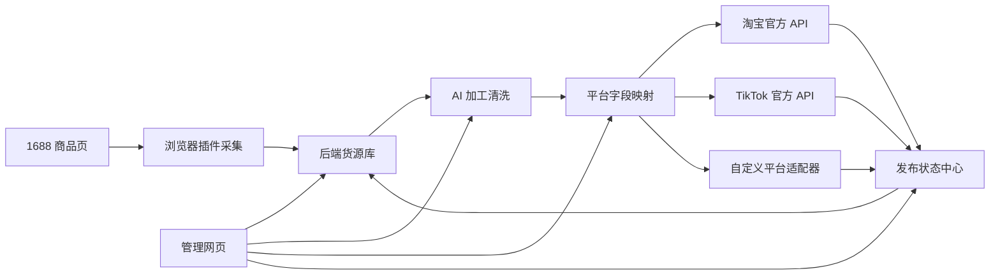
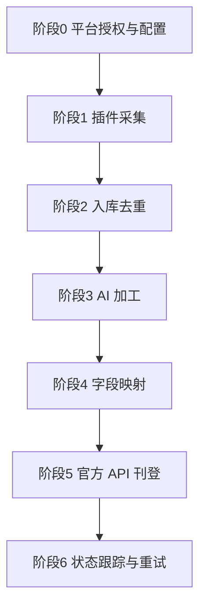
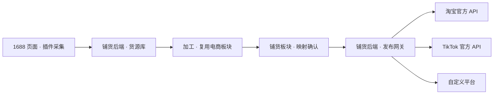

# 技术设计：1688 铺货插件（采集 → 加工 → 淘宝 / TikTok / 自定义平台上架）

关联需求：本文件为流程与功能设计（自用型铺货工具）。

## 1. 目标与范围

- 构建一套**自用**的铺货工具，链路为：在 1688 商品页一键采集 → 后端入库 → AI 加工清洗 → 一键/批量铺货到淘宝、TikTok Shop 及自定义平台。
- 形态：浏览器扩展（采集端）+ 后端服务（加工与刊登）+ 管理网页（运营端，可挂载到铜龙 AI 助手工作台）。
- 定位：**仅本公司自用**，不对外提供多租户服务；上架走各平台官方开放 API 的自用型应用授权。

不在范围内：对外 SaaS 多租户、订单履约/物流、支付结算、供应链议价。

## 2. 可行性前提（本方案的落地依据）

不同环节的取数/写入能力差异很大，方案据此选型：

| 环节 | 采用方式 | 可行性 | 说明 |
|---|---|---|---|
| 1688 读货 | **浏览器插件页面提取** | 可行 | 普通开发者拿不到 1688 官方读货 API，只有服务商/ISV 才可能获得；因此 1688 侧一律走「插件在用户已登录浏览器内提取」，不依赖官方 API |
| 淘宝 / 天猫上架 | **官方开放平台 API（自用型应用）** | 可行 | 企业认证 + 店铺主体授权，可申请商品发布类能力；自用无需入驻服务市场 |
| TikTok Shop 上架 | **TikTok Shop Partner / Open API（自用授权）** | 可行 | 公司资质注册 Partner，创建 App 授权自家店铺，申请 Product 等 scope |
| 抖音小店上架（可选） | 抖音开放平台自用型应用 | 可行 | 企业开发者认证后申请电商权限 |
| 自定义平台 | **通用 HTTP 适配器 / 表格导出** | 可行 | 由我方配置接口、鉴权与字段映射 |

结论：**读货靠插件、刊登靠官方 API** 是当前唯一稳定可行的组合。

## 3. 总体架构

三层职责：
- **采集端（插件）**：运行在用户浏览器，读取 1688 页面，抓取结构化商品数据与图片并回传后端。
- **后端服务**：商品库、加工、映射、平台 API 网关、发布任务队列、授权中心。
- **管理网页**：商品库浏览编辑、加工工作台、映射确认、批量发布、状态跟踪。

## 4. 端到端流程

### 阶段 0 · 准备
- 平台授权：淘宝 / TikTok / 自定义平台逐一向自有店铺完成 OAuth 授权，token 加密存储与自动刷新。
- 平台配置：平台清单、运费模板、加价规则、标题规则（字数/禁词）、字段映射模板。

### 阶段 1 · 采集（插件侧）
- 页面识别：判断当前是 1688 商品页，浮出「采集」按钮。
- 一键采集：抓标题、价格（含阶梯价）、SKU（规格组合、对应价与图）、主图、详情长图、类目、属性、货号、供应商。
- 懒加载处理：自动滚动触发详情图加载后再抓取。
- 采集预览：勾选保留字段与图片，删去不要的。
- 批量采集：列表页 / 收藏夹批量入队。
- 上传后端：结构化 JSON + 图片二进制。

### 阶段 2 · 入库
- 按 1688 商品 ID 去重；记录采集来源、时间、供应商。
- 编辑补全、分类打标、搜索。

### 阶段 3 · 加工（AI）
- 标题：本地化、关键词优化、去品牌词/敏感词、按目标平台标题规则裁剪。
- 文案：卖点提炼、详情描述生成。
- 多语言：TikTok 出海翻译。
- 图片：去水印、抠图白底、换背景、场景图/模特图、多尺寸适配、去同质化。
- 定价：成本价 × 加价率 + 平台手续费 + 跨境汇率。

### 阶段 4 · 映射
- 统一商品模型 → 各平台字段的映射器。
- 类目映射：1688 类目 → 淘宝/TikTok 类目（自动推荐 + 人工确认）。
- 属性映射：规格、材质、尺码等对应。
- 自定义平台：通过可编辑映射表接入。

### 阶段 5 · 刊登（官方 API）
- 逐平台发布器：淘宝、TikTok、自定义各一个。
- 批量发布 / 定时发布 / 草稿预览。
- 库存、价格、运费模板写入。
- 发布结果（平台商品 ID、状态、失败原因）回执入库。

### 阶段 6 · 跟踪运营
- 发布状态：成功 / 失败 / 审核中；失败自动重试（限次）。
- 数据同步：库存、价格、订单回填（可选）。
- 操作日志与审计。

## 5. 组件设计

### 5.1 浏览器扩展（Manifest V3）
- **content script**：
  - 1688 采集：识别商品页、提取字段与图片、滚动加载、预览确认。
  - 目标后台辅助填充：在淘宝/TikTok 卖家后台页面提供辅助（发布仍以 API 为主，此为兜底）。
- **background service worker**：与后端通信、任务轮询、登录态校验。
- **popup**：当前页采集按钮、采集队列、与账号绑定。
- 权限最小化：仅 `storage`、必要站点 `host_permissions`（1688 域名 + 自有后端域名）。

### 5.2 后端服务
- **货源库**：商品存储与去重。
- **授权中心**：平台 OAuth、token 加密（KMS/本地密钥）、刷新与失效告警。
- **发布任务队列**：限频、重试、并发控制、失败隔离。
- **平台 API 网关**：淘宝 / TikTok / 自定义 适配器，统一出入参。
- **AI 加工服务**：文案、图片、翻译（复用现有电商工作台能力）。
- **映射引擎**：类目/属性/字段映射表及其管理。
- **状态中心**：发布结果与同步状态。

### 5.3 管理网页
- 商品库列表与编辑、加工工作台、映射确认、批量发布、状态与失败重试、授权管理。
- 可作为「日常工具」分区的一个板块挂载到现有工作台（`XLX.tools` 新 tab / `XLX.SKILLS` 技能卡）。

### 5.4 自定义平台适配层
三种接入方式，覆盖未内置适配器的平台：
1. **通用 API 适配器**：配置平台名、发布接口 URL、鉴权方式（Bearer / Key / 签名）、字段映射表，后端按配置调用。
2. **标准表格导出**：生成平台可批量导入的 Excel / CSV。
3. **Webhook 推送**：将商品 JSON 推送到对方系统。

### 5.5 铺货板块 / 铺货后端 / 电商板块 的关系与数据流

三个平面的职责划分：

| 平面 | 性质 | 职责 |
|---|---|---|
| 电商板块（现有） | 前端创作工作台 | 加工创作：作图、详情图、主图、本地化、视频等 |
| 铺货板块（新增） | 前端新板块 | 货源库浏览、类目/字段映射确认、发布操作、状态查看 |
| 铺货后端（新增服务） | 后端服务 | 货源库、授权中心、发布网关、任务队列、状态 |

> 说明：现有电商板块没有商品库/授权/上架能力的后端，因此「铺货后端」是全新服务，二者不是同一个后端。

数据流：

关键约定：
- **采集不能直接上架**：必经「加工」与「平台映射」两道工序，上架由后端带店铺授权 token 调官方 API 完成。
- **数据落在铺货后端**，而非电商板块（后者无后端）。
- **视觉样式**：铺货板块是全新功能页面，视觉沿用现有设计语言（配色/组件），保持整套产品一致；不另造一套视觉规范。
- **加工分工**：单件精修在前端电商板块做（人可见可调），批量自动化在铺货后端做。
- **快速直发通道（可选）**：字段与图片已合规时，可跳过加工直接映射发布；默认仍走标准流程。

## 6. 平台接口与授权

> 具体接口名与权限包以各平台官方文档为准，以下仅为能力范围。

### 6.1 淘宝 / 天猫（官方开放平台，自用型应用）
- 授权：企业开发者 + 企业认证 + 自有店铺 OAuth。
- 能力：商品发布、商品编辑、图片空间上传、类目与属性查询、店铺信息。
- 流程：创建应用 → 申请商品发布权限包 → 场景审核 → 获取 appKey/appSecret → 授权店铺 → 调用。

### 6.2 TikTok Shop（Partner / Open API，自用授权）
- 授权：公司资质注册 Partner，创建 App，授权自家店铺。
- 能力 scope：Product（商品创建/编辑）、Order、Logistics、Shop。
- 注意：跨境资料需英文，可能含合规问卷。

### 6.3 自定义平台
- 配置驱动：平台元数据 + 鉴权 + 字段映射 + 发布接口；无 API 的平台走表格导出。

## 7. 统一商品数据模型

| 分组 | 字段 |
|---|---|
| 源信息 | 1688 商品 ID、原始链接、供应商、采集时间 |
| 展示 | 标题、描述、卖点 |
| 图片 | 主图列表、详情图列表、白底图、场景图 |
| SKU | 规格组合、价格、库存、SKU 图、条码、重量尺寸 |
| 类目属性 | 源类目、目标类目、属性键值 |
| 定价 | 成本价、售价、加价率、币种 |
| 发布 | 目标平台、状态、平台商品 ID、失败原因 |

## 8. 功能清单（模块 → 功能点）

### 插件端
- 商品页识别与浮标
- 字段提取（标题 / 价格 / SKU / 图片 / 属性 / 类目）
- 详情图懒加载滚动抓取
- 采集预览与勾选
- 批量采集
- 采集结果推送后端
- 目标后台辅助填充（兜底）

### 后端服务
- 货源库与去重
- 平台授权中心（OAuth + token 刷新）
- 发布任务队列（限频 / 重试 / 并发控制）
- 平台 API 网关（淘宝 / TikTok / 自定义适配器）
- AI 加工服务（文案 + 图片 + 翻译）
- 类目 / 属性映射引擎
- 日志与状态跟踪

### 管理网页
- 商品库列表与编辑
- 加工工作台（标题 / 图 / 文案）
- 类目属性映射确认
- 发布配置与批量发布
- 发布状态与失败重试
- 平台授权管理

## 9. 关键技术点

- **详情图获取**：1688 详情图为懒加载长图，需滚动触发后按序拼接/抓取原图 URL。
- **SKU 组合**：多规格（颜色 × 尺寸）需枚举组合，映射到目标平台的 SKU 结构。
- **类目映射**：无一一对应，采用「自动推荐 + 人工确认」，降低错类目导致的下架风险。
- **图片管线**：去水印/抠图/尺寸规格化统一走处理流水线，输出目标平台要求的尺寸与格式。
- **限频与重试**：平台 API 有配额，发布任务需令牌桶限频 + 指数退避重试。
- **反爬与合规边界**：采集仅在用户已登录浏览器内、针对用户可见的公开商品页执行；不做服务端大规模抓取、不绕过风控、不采集非公开数据。

## 10. 分期落地

1. **一期**：插件采集 + 后端货源库 + 淘宝官方 API 发布（跑通「取得到、发得出」）。
2. **二期**：TikTok 官方 API 发布 + 图片/文案 AI 加工 + 类目映射。
3. **三期**：自定义平台适配器 + 批量/定时发布 + 状态中心。
4. **四期**：订单/库存同步、多语言出海增强。

## 11. 风险与合规

- **平台政策变动**：开放平台权限与接口会调整，需持续跟进官方文档并留适配层。
- **采集合规**：坚持「已登录浏览器内、仅公开页面、单用户正常速率」；不规避平台风控。
- **上架合规**：商品需符合目标平台类目与资质要求（部分类目需资质）。
- **资质周期**：TikTok 跨境审核较长，建议与国内平台并行推进。
- **数据安全**：token 与店铺凭据加密存储，权限最小化。

## 12. 建议交付（后续实施时）

- 浏览器扩展：`extension/`（manifest、content、background、popup）。
- 后端服务：`server/`（商品库、授权、网关、队列、AI 加工）。
- 管理网页：现有工作台新增「铺货」板块（`XLX.tools` 新 tab + `XLX.SKILLS` 技能卡）。
- 平台适配器：`server/adapters/{taobao,tiktok,custom}`。
- 文档与测试：本 specs 目录 + 单测/E2E。
